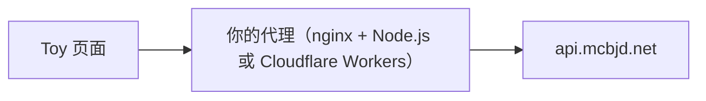

# 布吉岛玩家数据查询

这是一个采用 Minecraft Ore UI 风格的哔哩哔哩 Toy，用于查询布吉岛 Minecraft 服务器的玩家战绩，支持在 B 站 App 内使用和在浏览器中本地预览。

**AGPL-3.0-only**，见 [LICENSE](LICENSE)。修改本项目并通过网络向他人提供服务（包括只部署修改后的代理），也必须向这些用户公开对应的完整源码。

本项目非布吉岛、哔哩哔哩或 Mojang 官方项目。Minecraft 为 Mojang 的商标。使用时须遵守布吉岛开放接口使用须知，严禁使用接口获取不公平优势，例如在游戏中使用 Overlay。详见[布吉岛开放接口文档](https://mcbjd.net/docs/api/bugland-api)。

## 功能

- 查看玩家总览、起床战争、空岛战争和其他模式的统计。
- 浏览对局记录及详情、玩家排名和榜单、公会资料及 2025 年度统计。
- 绑定「我的 ID」。支持云存储时使用键 `bjd_mine`，浏览器也通过 `localStorage` 保存绑定。
- 在 B 站 App 内分享，网页端可展示分享二维码。通过关注检查后，带 `?u=玩家名` 的链接会自动查询指定玩家。

## 架构



上游 CORS 仅放行 `https://mcbjd.net`，且 Token 不能下发到前端，所以 Toy 通过代理查询，由代理在服务端注入 Token。

两种部署方案共用 `proxy/worker.js`。代理只转发白名单内的接口和字段，`/gamestats` 的 `gametype` 也须在白名单内，请求体上限为 2 KiB。生产请求必须携带白名单内的 `Origin`，只有本地预览通过 `ALLOW_NO_ORIGIN` 放行无 `Origin` 的请求。

## 快速开始（本地预览）

1. 准备 Node.js 20 或更高版本。布吉岛账号等级大于 20 后，在大厅输入 `/openapi` 申领自己的 OpenAPI Token。
2. 在项目根目录执行以下命令，将 Token 填入 `key.txt`，并保持 `toy/config.js` 的 `apiBase` 为 `/v2`。

   ```sh
   cp key.txt.example key.txt
   ```

3. 启动预览服务器。

   ```sh
   node dev-server.mjs
   ```

   也可以跳过 `key.txt`，把 `...` 替换成自己的 Token，通过环境变量启动。

   ```sh
   BJD_TOKEN=... node dev-server.mjs
   ```

4. 打开 <http://127.0.0.1:5173/?u=玩家名>。预览服务只监听 `127.0.0.1`，通过同源的 `/v2` 查询。`localhost` 和 `127.0.0.1` 上默认跳过关注检查，代理仍启用内存限流。可分别使用 `?tier=triple` 试用三连档、`?forceGate=1` 查看关注门槛界面。与 `u` 一起使用时，用 `&` 追加参数。

## 需要你填写的配置清单

| 位置 | 键 | 说明 | 是否必填 |
| --- | --- | --- | --- |
| Debian 的 `/etc/bjd-proxy/env`、Cloudflare Wrangler secret 或本地预览 | `BJD_TOKEN` | 填自己的 OpenAPI Token。本地也可将 Token 直接写入根目录 `key.txt`。 | 必填，按所选环境配置 |
| `/etc/bjd-proxy/env` 或 `proxy/wrangler.toml` 的 `[vars]` | `ALLOWED_ORIGINS` | 逗号分隔。默认允许 `https://www.bilibilitoy.com`（Toy 实际托管域名）、`https://www.bilibili.com` 和 `https://m.bilibili.com`，按实际 `Origin` 调整。 | 选填 |
| `/etc/bjd-proxy/env` | `PORT` | Node 代理端口，默认 `8787`。修改后同步更新 nginx 的 `proxy_pass`。 | 选填 |
| `/etc/bjd-proxy/env` 或 `proxy/wrangler.toml` 的 `[[ratelimits]]` | `RL_IP`、`RL_USER_BASIC`、`RL_USER_TRIPLE` | 默认每 60 秒分别为 40、10、20 次，仅计入缓存未命中的请求。 | 选填 |
| `deploy/nginx-bjd-api.conf` 安装后的 nginx 站点配置 | `server_name` | 将 `api.example.com` 替换成自己的代理域名。 | Debian 方案必填 |
| `toy/config.js` | `apiBase` | 发布前改成自己的 HTTPS 代理地址，保留 `/v2` 后缀。本地预览用 `/v2`。 | 发布时必填 |
| `proxy/wrangler.toml` 顶层 | `routes` | Cloudflare 生产方案使用自己的自定义域名，以启用 Cloudflare Cache API。 | Cloudflare 生产部署需配置 |
| B 站 Toy 平台 | OpenID 模式 | 未开启时无法取得 `toyOpenId`，所有用户都按 IP 计基础档额度。 | 基础档选填，按用户计额或三连提额需开启 |
| B 站作者账号 | 近一年内发布的视频 | 用户须给作者近 365 天内发布的任一视频完成点赞、投币和收藏，才可升至三连档。 | 三连提额需要 |

## 部署方案 A：Debian 12 + nginx

下面的 `api.example.com` 是示例域名。执行命令前请换成自己的域名，并从项目根目录操作。nginx 只对外代理 `/v2/*`。

1. 添加指向服务器 IP 的 DNS A 记录。服务器位于中国大陆时，域名需先办理 ICP 备案。
2. 安装 Node.js 22、nginx 及 Certbot。Debian 12 自带的 Node.js 18 不满足项目最低版本要求。

   ```sh
   sudo apt update
   sudo apt install -y ca-certificates curl
   curl -fsSL https://deb.nodesource.com/setup_22.x | sudo bash -
   sudo apt install -y nodejs nginx certbot python3-certbot-nginx
   node -v
   ```

3. 将代理文件复制到 `/opt/bjd-proxy/`。

   ```sh
   sudo mkdir -p /opt/bjd-proxy
   sudo cp proxy/worker.js proxy/limiter.js proxy/node-server.mjs proxy/package.json /opt/bjd-proxy/
   ```

4. 安装仅 root 可读写的环境变量文件，并填入自己的 `BJD_TOKEN`。

   ```sh
   sudo mkdir -p /etc/bjd-proxy
   sudo install -o root -g root -m 600 deploy/bjd-proxy.env.example /etc/bjd-proxy/env
   sudoedit /etc/bjd-proxy/env
   ```

5. 安装并启动 systemd 服务。健康检查应返回 `ok`，改过 `PORT` 时请使用对应端口。

   ```sh
   sudo cp deploy/bjd-proxy.service /etc/systemd/system/
   sudo systemctl daemon-reload
   sudo systemctl enable --now bjd-proxy
   curl http://127.0.0.1:8787/healthz
   ```

6. 安装 nginx 站点配置，将 `server_name` 改成自己的域名。有自定义 `PORT` 时，同时修改 `proxy_pass`。启用站点后用 Certbot 配置 HTTPS。

   ```sh
   sudo cp deploy/nginx-bjd-api.conf /etc/nginx/sites-available/bjd-api.conf
   sudoedit /etc/nginx/sites-available/bjd-api.conf
   sudo ln -s /etc/nginx/sites-available/bjd-api.conf /etc/nginx/sites-enabled/
   sudo nginx -t && sudo systemctl reload nginx
   sudo certbot --nginx -d api.example.com --redirect
   ```

7. 检查跨域预检。使用默认白名单时，响应应为 HTTP 204 并带有 `Access-Control-Allow-Origin: https://www.bilibili.com`。

   ```sh
   curl -i -X OPTIONS https://api.example.com/v2/player \
     -H 'Origin: https://www.bilibili.com' \
     -H 'Access-Control-Request-Method: POST' \
     -H 'Access-Control-Request-Headers: content-type,x-toy-user,x-toy-tier'
   ```

8. 将 `toy/config.js` 的 `apiBase` 设为 `https://api.example.com/v2`，然后按下文发布 Toy。

### 运维

- 换 Token 或调整环境变量后，执行 `sudo systemctl restart bjd-proxy`。更新代理代码时，覆盖 `/opt/bjd-proxy/` 中的对应文件后重启服务。
- 用 `sudo journalctl -u bjd-proxy -f` 查看服务日志。nginx 访问日志 `/var/log/nginx/bjd-api.access.log` 记录 `origin=` 和 `cache=`。
- Node 代理使用进程内缓存和滑动窗口限流，重启后缓存与计数清零。运行一个 Node 进程即可。
- 客户端 IP 取自 nginx 设置的 `X-Real-IP`。如在 nginx 前接入 CDN，须让 nginx 从可信的 CDN 节点恢复真实客户端 IP，否则同一 CDN 节点后的用户会共用额度。
- nginx 对每个 IP 另设每秒 5 次、突发 20 次的防洪限制，缓存命中也计入。nginx 返回的 429 没有 CORS 响应头，页面会显示「网络异常」。

## 部署方案 B：Cloudflare Workers

1. 在 `proxy/wrangler.toml` 顶层的 `[vars]` 之前启用下面的 `routes`，将示例域名替换为自己在 Cloudflare 管理的域名。`*.workers.dev` 上 Cloudflare Cache API 不生效，只能复用同一 Worker 隔离实例内的缓存。

   ```toml
   routes = [{ pattern = "bjd-api.example.com", custom_domain = true }]
   ```

2. 从项目根目录执行以下命令。Wrangler 提示时登录 Cloudflare 并输入自己的 Token。

   ```sh
   cd proxy
   npx wrangler deploy
   npx wrangler secret put BJD_TOKEN
   ```

3. 将 `toy/config.js` 的 `apiBase` 指向自己的 HTTPS 代理，例如 `https://bjd-api.example.com/v2`。

修改 `ALLOWED_ORIGINS` 或其他 Wrangler 配置后，在 `proxy/` 中重新执行 `npx wrangler deploy`。更换 Token 时重新执行 `npx wrangler secret put BJD_TOKEN` 即可。

## 发布 Toy

1. 确认 `toy/config.js` 的 `apiBase` 指向自己的 HTTPS 代理，保留 `/v2` 后缀。
2. 在 B 站 Toy 平台仅上传 `toy/` 中的内容，以 `index.html` 为入口。需要按用户计额及三连提额时，开启 OpenID 模式。
3. 上线后在 B 站 App 中打开 Toy 并发起一次查询。使用 Debian 方案时，查看 `/var/log/nginx/bjd-api.access.log` 中的 `origin=`，确认 App 实际发送的 `Origin`。如与默认白名单不同，把确认后的来源加入 `ALLOWED_ORIGINS` 并重新加载代理配置。

## 访问规则与额度

用户须在 B 站 App 登录并关注作者，再点击「开始使用」。给作者近 365 天内发布的任一视频点赞、投币并收藏后，有有效 `toyOpenId` 的用户可升至三连档。没有有效 `toyOpenId` 时，同一 IP 上的用户共用基础档额度。缓存未命中时，代理先按客户端 IP 检查 `RL_IP`，再检查对应档位的额度。

| 限流项 | 默认每 60 秒上限 | Cloudflare 命名空间 ID |
| --- | ---: | --- |
| `RL_IP`（每个客户端 IP） | 40 | `1001` |
| `RL_USER_BASIC`（基础档） | 10 | `1002` |
| `RL_USER_TRIPLE`（三连档） | 20 | `1003` |

布吉岛文档给出的普通玩家 Token 上限为 30 次/分，有效期 30 天。开发者 Token 上限为 200 次/分，有效期 180 天，部分开发者 Token 额度更高。请在本地查看自己 Token 的 JWT 载荷中的 `limit`，按实际额度和访问量调整 `RL_*`。同一 Token 的上游额度由所有用户共享，单 IP 或单用户限流无法约束总量。Cloudflare 的三个限流绑定均为可选，按数据中心独立计数，限额为近似值。Token 过期或触发限流时，页面会提示错误。额度说明见[布吉岛开放接口文档](https://mcbjd.net/docs/api/bugland-api)。

关注状态、三连状态及 `toyOpenId` 由客户端 SDK 获取。Toy 通过 `X-Toy-User` 和 `X-Toy-Tier` 传递用户标识与档位，这两个请求头都可伪造，`toyOpenId` 不能用作认证凭据。`Origin` 白名单也无法区分同源的不同 Toy。缓存和 IP 限流能减少上游请求。

缓存命中不扣代理的 IP 或用户额度。代理按接口和规范化后的请求参数查进程内 `Map`，Cloudflare 部署再查 Cache API。仅缓存 HTTP 状态和响应体 `code` 均为 `200` 的结果，并用响应头 `X-Proxy-Cache` 标记 `HIT` 或 `MISS`。下表路径均相对于 `/v2`。

| 接口 | 缓存时长 |
| --- | ---: |
| `/player` | 300 秒 |
| `/player/2025total` | 3600 秒 |
| `/gamestats` | 300 秒 |
| `/guild` | 300 秒 |
| `/leaderboard` | 300 秒 |
| `/gamelog/user` | 60 秒 |
| `/gamelog/match` | 3600 秒 |

## 本地开发与贡献

```text
toy/                          Toy 页面，入口为 index.html
├── app.js                    查询、关注门槛、渲染和分享
├── style.css                 页面样式
└── config.js                 API 代理地址
proxy/
├── worker.js                 Cloudflare Worker 与 Node 共用的代理逻辑
├── node-server.mjs           Node 代理入口
├── limiter.js                Node 与本地预览的进程内限流器
├── package.json              代理的 ES 模块配置
└── wrangler.toml             Cloudflare 部署配置
deploy/
├── bjd-proxy.service         systemd 服务
├── bjd-proxy.env.example     生产环境变量模板
└── nginx-bjd-api.conf        nginx 站点模板
dev-server.mjs                本地预览入口
package.json                  项目配置和 dev 脚本
key.txt.example               本地 Token 文件模板
```

修改后将 `apiBase` 设为 `/v2`，运行 `npm run dev` 或 `node dev-server.mjs`，本地验证查询和相关页面。涉及关注、三连或 OpenID 的改动，还需在支持 Toy SDK 的 B 站 App 内验证。

`.gitignore` 已忽略 `key.txt`。请把凭据留在服务端，切勿放入 `toy/`。提交前检查暂存区，确保未包含 `key.txt`、实际使用的 `env` 或任何 Token。提交 PR 的代码须以 AGPL-3.0-only 授权。

## 已知限制

- 成就（`achievement`）接口返回英文代码，页面暂未展示成就数据。
- 部分模式的中文名为推断，未知模式直接显示接口返回的代码。
- 缺少 B 站 Toy SDK 支持的环境无法在正式版通过关注检查。可用本地预览测试页面。
- 页面显示的剩余额度按当前页面近 60 秒的请求估算。若调整代理的基础档或三连档上限，需同步更新 `toy/app.js` 中的档位说明和额度显示。

## 许可证

Copyright (C) 2026 本项目贡献者

本程序是自由软件，按 GNU Affero 通用公共许可证第 3 版（AGPL-3.0-only）授权。你可以依据该许可证重新分发和修改本程序。如果你修改了本程序，并让用户通过网络与修改版交互（例如部署修改后的 Toy 或代理服务），须按许可证第 13 条向这些用户提供修改版的完整对应源码。本程序按现状提供，不附带任何担保，包括适销性或特定用途适用性的默示担保。完整条款见 [LICENSE](LICENSE)。
